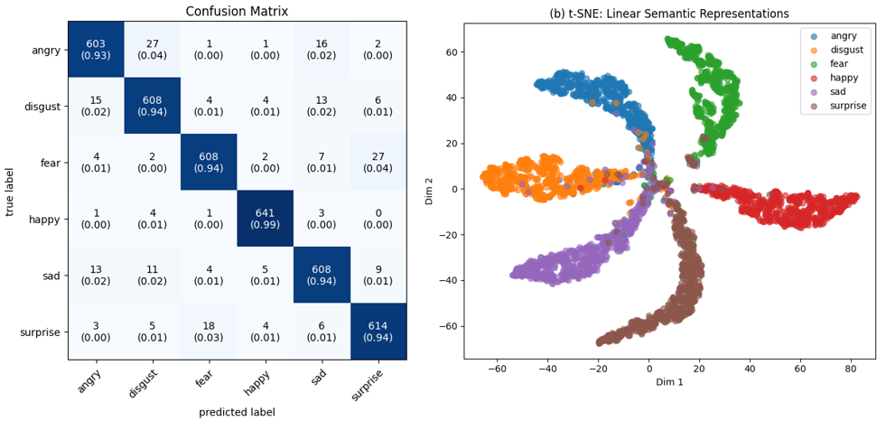
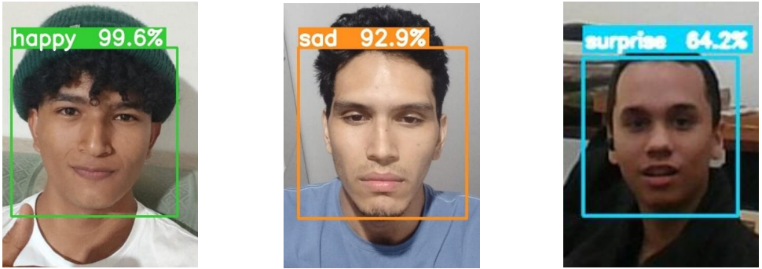

# Facial Emotion Recognition using Residual Networks and Angular Margin Based Discriminative Learning

Research code accompanying a manuscript under revision by Jose Carlos Arroyo Cantero, Lucas Mateo Rivadeneira Zarza, Enoc David Samur Martínez, and Wilson de Jesús Arrubla Hoyos. The study examines residual networks for classifying facial images into six expression categories: **angry, disgust, fear, happy, sad, and surprise**.

**[Reproducibility materials, supplementary tables, and selected checkpoints on Zenodo](https://doi.org/10.5281/zenodo.24238802)** · [Original notebook in this repository](FER_ResNet_ArcFace.ipynb)

**Universidad de Sucre · Sincelejo, Colombia**

## Overview

The work studies how an additive angular margin, its training schedule, label smoothing, and the residual backbone affect facial-expression classification. JLE is a balanced, heterogeneous collection assembled for the study; a six-class adaptation of FER2013 provides a second evaluation setting. Five configurations make the effect of training choices visible across both collections. The results support the scheduled ArcFace configuration on JLE, while cross-entropy performs substantially better on FER2013. This difference is central to the interpretation of the study.

| Class index | 0 | 1 | 2 | 3 | 4 | 5 |
| --- | --- | --- | --- | --- | --- | --- |
| Expression label | angry | disgust | fear | happy | sad | surprise |

## What this repository contains

This GitHub repository preserves the original `FER_ResNet_ArcFace.ipynb` notebook and the figures used to present the initial experiment. The [Zenodo release (v1.0.0)](https://doi.org/10.5281/zenodo.24238802) contains the **revised, separate notebooks for Exercises E1–E5**, two visualization/attribution notebooks, supplementary result tables, a README with input requirements, and two selected model checkpoints. Use the Zenodo notebooks when examining or rerunning the revised experiments; the original notebook here does not implement the full E1–E5 comparison.

| Location | Materials | Role |
| --- | --- | --- |
| This repository | [`FER_ResNet_ArcFace.ipynb`](FER_ResNet_ArcFace.ipynb), [`pictures/`](pictures/), [`LICENSE`](LICENSE) | Historical implementation and illustrative figures. |
| [Zenodo release](https://doi.org/10.5281/zenodo.24238802) | `Exercise_1.ipynb`–`Exercise_5.ipynb`, `Feature_Visualization_ResNet56.ipynb`, `Facial_Attribution_Analysis.ipynb`, `Supplementary_Tables.xlsx`, `model_acc_94_41.pt`, `E1_best_seed5_acc_80_54.pt` | Revised experimental code, analysis notebooks, detailed results, and selected checkpoints. |

The image collections, including JLE, are **not distributed**. JLE cannot be shared under the applicable privacy and source-use restrictions. Authorized users must obtain or prepare their own permitted input data; the public files alone cannot reproduce every numerical result in the manuscript.

## Architecture and training strategy

The proposed network takes **128 × 128 grayscale images**. Its residual blocks use 3 × 3 convolutions, with channel widths progressing through 32, 64, 128, and 256 before a final 128-channel stage. It combines ReLU and SiLU activations, spatial downsampling, a dense embedding, and an `ArcMarginProduct` classification head. Selected residual stages use Drop Path, with a maximum probability of 0.05. The [architecture diagram](pictures/architecture.svg) illustrates the design; the executable definitions in the [E1 notebook](https://zenodo.org/records/24238802) are authoritative for the revised experiment.

For a sample with target class $y_i$, the angular-margin loss uses normalized features and class weights and applies the margin to the target logit:

$$
\mathcal{L}_i = -\log\frac{\exp\left[s\cos(\theta_{y_i}+m)\right]}{\exp\left[s\cos(\theta_{y_i}+m)\right]+\sum_{j\ne y_i}\exp\left[s\cos(\theta_j)\right]}.
$$

Here $m$ is the additive angular margin, $s$ scales the logits, and $\theta_j$ is the angle associated with class $j$. The `ArcMarginProduct` implementation was initially informed by [ronghuaiyang/arcface-pytorch](https://github.com/ronghuaiyang/arcface-pytorch); the schedule and complete training definitions for this study are provided in the deposited notebooks. This loss encourages an angular class separation objective, but qualitative plots alone do not verify that it has been achieved for every class or collection.

In E1, the margin and scale change during early training rather than taking their final values from the first epoch:

| Parameter | Start | At zero-based epoch 10 | From zero-based epoch 15 |
| --- | ---: | ---: | ---: |
| Angular margin $m$ | 0.10 | 0.24 | 0.30 |
| Logit scale $s$ | 10 | 25 | 25 |

The original and revised protocols share the basic optimization family but differ in duration, data partitions, and repetition. The table summarizes the documented settings; individual notebooks should be consulted for exact implementation and configuration-specific exceptions.

| Training setting | Original run | Revised E1–E5 runs |
| --- | --- | --- |
| Epochs | 101 | 50 per run |
| Optimizer | SGD, momentum 0.9, Nesterov | SGD, momentum 0.9, Nesterov |
| Backbone weight decay | $10^{-4}$ | $10^{-4}$ in the proposed-network configuration |
| Batch size | 160 | 160 |
| Learning-rate schedule | OneCycleLR, maximum rate 0.05 | See each notebook's OneCycleLR configuration |
| Mixed precision | FP16 | CUDA automatic mixed precision |
| Label smoothing | $\varepsilon=0.05$ before epoch 50, $0.02$ in epochs 50–79, then 0 | E1 and E3 retain smoothing; E4 removes it |
| Random seeds | Original run's setting | 5, 51015, and 543210 for every collection/configuration |

## Experimental design

JLE contains 39,000 images, balanced at 6,500 files per category. The revised evaluation also uses a six-class adaptation of FER2013, excluding neutral and retaining its supplied `Training`, `PublicTest`, and `PrivateTest` assignments for training, validation, and test. The five configurations were evaluated on both collections with seeds `5`, `51015`, and `543210` (30 training runs in total). Within each collection, the exercises used the same prepared partitions. Each run retained the last checkpoint and the one selected by validation accuracy; test performance was reported separately for both.

| Exercise | Configuration | Comparison |
| --- | --- | --- |
| E1 | Proposed residual network with ArcFace, scheduled angular margin and scale, and label smoothing | Main configuration. |
| E2 | Same network trained with cross-entropy | Loss function relative to E1. |
| E3 | Proposed network with fixed ArcFace margin and scale; label smoothing retained | Angular-parameter schedule relative to E1. |
| E4 | E3 without label smoothing | Label smoothing relative to E3. |
| E5 | Alternative residual architecture with the E1 ArcFace strategy | Architecture relative to E1. |

The revised runs used 50 epochs. Details of the network, schedules, preprocessing, and exported metrics are documented in the individual Zenodo notebooks. The prepared JLE test split contains real photographs and was reviewed manually for visible identity overlap with the training and validation images. This manual check does not establish a complete subject- and sequence-level audit for all sources.

## Results and interpretation

The initial experiment trained for **101 epochs** on an image-random partition of JLE and reported **94.41% test accuracy**, 0.9442 macro precision, 0.9441 macro recall, and 0.9441 macro F1 on 3,900 images. That split could place related images or the same identity in different partitions. The values are retained as historical results and should not be interpreted as estimates under the revised evaluation conditions.

The values below summarize the **best-validation checkpoints** across three seeds under the revised protocol; they are test metrics, not validation metrics.

| Collection | E1 accuracy | E1 macro F1 | E2 accuracy | E2 macro F1 |
| --- | ---: | ---: | ---: | ---: |
| JLE, revised test split | 80.17 ± 0.42% | 78.37 ± 0.53% | 72.84 ± 1.21% | 69.87 ± 1.52% |
| FER2013, six classes | 38.58 ± 2.85% | 25.60 ± 1.53% | 68.50 ± 0.19% | 66.64 ± 0.05% |

E1 exceeded E2 by **7.33 percentage points** of accuracy on JLE; E2 exceeded E1 by **29.92 points** on the six-class FER2013 evaluation. These within-collection contrasts show that the benefit of the angular-margin training strategy depends on the data and optimization conditions. They do not establish a universal advantage for ArcFace. On JLE, E1's mean recall for **fear** was 29.80%, despite its substantially higher recall for other classes. The initial 94.41% and the revised 80.17% also differ in split and training duration, so the numerical gap cannot be assigned solely to the split change.

For per-seed results, per-class recall, and the other ablations, see [`Supplementary_Tables.xlsx` on Zenodo](https://zenodo.org/records/24238802). Qualitative figures such as confusion matrices, t-SNE projections, attribution maps, and filter-activation visualizations illustrate model behavior; they do not prove identity invariance, causal explanations, or robustness by themselves.

### Historical class-level results and illustrations

The original 3,900-image test set had 650 images per class. The following per-class metrics belong **only to the initial image-random evaluation**. They must not be substituted for metrics from the revised JLE split.

| Class | Precision | Recall | F1 | Support |
| --- | ---: | ---: | ---: | ---: |
| angry | 0.9437 | 0.9277 | 0.9356 | 650 |
| disgust | 0.9254 | 0.9354 | 0.9304 | 650 |
| fear | 0.9560 | 0.9354 | 0.9456 | 650 |
| happy | 0.9756 | 0.9862 | 0.9809 | 650 |
| sad | 0.9311 | 0.9354 | 0.9332 | 650 |
| surprise | 0.9331 | 0.9446 | 0.9388 | 650 |

The [historical confusion-matrix and embedding figure](pictures/metrics_representations.png) is retained for documentation. Its apparent class separation is a two-dimensional t-SNE visualization under the initial protocol, not an independent measure of generalization or identity invariance.

### Revised JLE recall by class

For the E1 best-validation checkpoints evaluated on the revised JLE test split, mean recall across the three seeds was as follows (mean ± sample standard deviation, in percentage points; 650 real photographs per class):

| angry | disgust | fear | happy | sad | surprise |
| ---: | ---: | ---: | ---: | ---: | ---: |
| 89.28 ± 1.98 | 90.16 ± 0.56 | 29.80 ± 2.59 | 96.46 ± 0.62 | 79.64 ± 2.67 | 95.69 ± 0.96 |

The comparatively low recall for fear is a substantive limitation concealed by overall accuracy. The following inference illustration shows selected examples from the original presentation. These particular photographs were outside JLE, although the people depicted appear in other images in the collection. The illustrations are neither revised test-set metrics nor evidence of identity invariance.

## Using the released notebooks

Open the [Zenodo record](https://doi.org/10.5281/zenodo.24238802) and read its `README.md` before running an exercise. The notebooks target Google Colab with a CUDA-capable PyTorch environment and accept an authorized archive named `[DATASET].zip` after configuring its path. They expect six class directories under `train/`, `val/`, and `test/` (or the FER2013 aliases `Training/`, `PublicTest/`, and `PrivateTest/`, which they normalize). Run one seed and one collection at a time, keeping split membership and class indices fixed across exercises. The notebooks export run metadata, checkpoint evaluations, histories, and per-class results.

The two released `.pt` files represent **different protocols**: `model_acc_94_41.pt` is associated with the initial image-random experiment, while `E1_best_seed5_acc_80_54.pt` is the E1 checkpoint selected by validation accuracy in the revised JLE evaluation (seed 5). The number in the latter filename denotes its reported test accuracy; test results were not used to select the checkpoint.

### Original notebook in Google Colab

[Open `FER_ResNet_ArcFace.ipynb` in Colab](https://colab.research.google.com/github/ILuuI/facial-emotion-recognition-resnet-arcface/blob/main/FER_ResNet_ArcFace.ipynb) to inspect the historical code. It corresponds to the initial experiment. For the separate revised exercises and their input contract, start with the [Zenodo README](https://zenodo.org/records/24238802) instead.

## Authors and contributions

| Author | Contribution in the manuscript | ORCID |
| --- | --- | --- |
| Jose Carlos Arroyo Cantero | Data curation, investigation, methodology, project administration, software, visualization, validation, original draft, review and editing | [0009-0009-9449-8105](https://orcid.org/0009-0009-9449-8105) |
| Lucas Mateo Rivadeneira Zarza | Data curation, investigation, methodology, software, visualization, original draft, review and editing | [0009-0004-7201-2905](https://orcid.org/0009-0004-7201-2905) |
| Enoc David Samur Martínez | Data curation, investigation, methodology, software, visualization, original draft, review and editing | [0009-0002-7579-4944](https://orcid.org/0009-0002-7579-4944) |
| Wilson de Jesús Arrubla Hoyos | Supervision | [0000-0001-7119-7603](https://orcid.org/0000-0001-7119-7603) |

## Scope, citation, and rights

These models classify **facial-image expression labels**. Their predictions do not determine a person's internal emotional or psychological state, and the study does not establish clinical diagnostic validity. The data include different image types, including posed, synthetic, and illustrative faces; performance can vary by source and class.

The notebook code in this GitHub repository is provided under the [MIT License](LICENSE). The Zenodo record identifies MIT for its notebook code and CC BY 4.0 for its README, supplementary tables, and selected model weights; consult its file-level license statement. Neither license grants rights to third-party datasets or private images absent from the release. If you use the released materials, cite the **[Zenodo version DOI](https://doi.org/10.5281/zenodo.24238802)**. The manuscript is under revision and does not yet have a final publication DOI.
